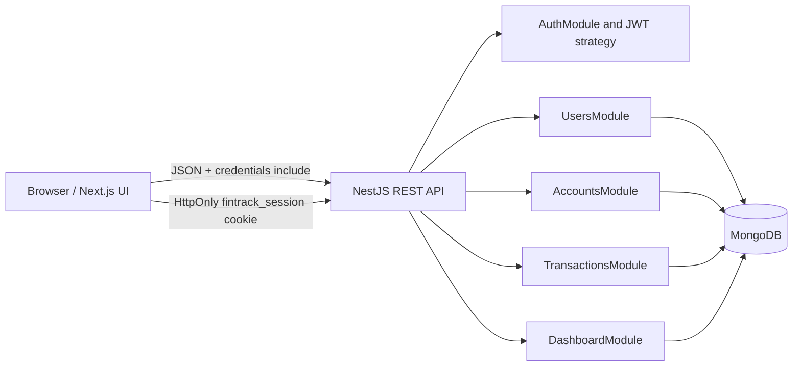

# Architecture

FinTrack is an npm-workspaces monorepo. `apps/web` is the Next.js App Router frontend;
`apps/api` is the NestJS REST API. The API connects to the configured MongoDB deployment
through one Mongoose connection.

## Request and session flow

The browser calls the typed client in `apps/web/src/lib/api.ts`, which sends JSON requests
with `credentials: include`. Successful login sets `fintrack_session` as HttpOnly. The
Passport JWT strategy validates signature and expiration, reads the token from that cookie,
then loads a safe public user record. Protected services receive this verified user's ID;
they do not use browser-supplied ownership IDs.

API mutation endpoints use the trusted-origin guard. CORS is credentialed and restricted to
the configured `FRONTEND_URL`. The web server also checks the session for protected pages.
Backend authorization remains the security boundary for financial records.

## NestJS module responsibilities

- `AuthModule`: registration/login/logout, JWT module/strategy, origin guard.
- `UsersModule`: user persistence, password hashing, normalized email lookup.
- `AccountsModule`: account CRUD and transaction-aware deletion.
- `TransactionsModule`: transaction CRUD, account ownership checks, filtering/pagination.
- `DashboardModule`: aggregation for per-currency balances and reporting period charts.
- `HealthModule`: API liveness endpoint; it does not report MongoDB health.

## Financial behavior

Amounts are positive integer `amountMinor` values. Currency precision is determined using
ISO 4217 formatting at the UI edge; no floating-point addition is used by API totals.
Dashboard totals remain grouped by currency. The tracked balance is the all-time sum of
recorded income minus expenses, not a bank balance. No opening balance, transfer, or FX
model exists.

Account deletion is rejected while transactions remain. Transaction creation, reassignment,
deletion, and account deletion use MongoDB transactions plus an account-side counter. The
configured deployment must support MongoDB transactions (Atlas does).
